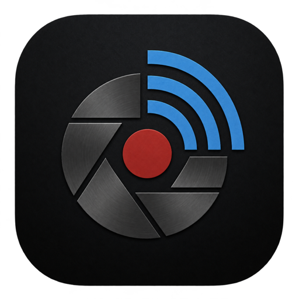
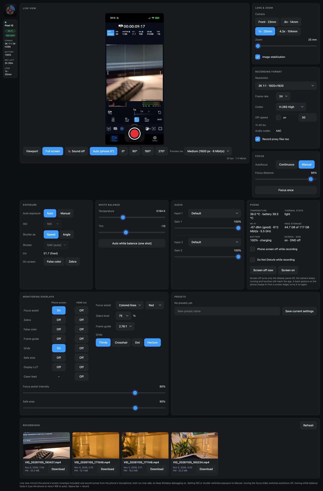

<p align="center"></p>

<h1 align="center">Blackmagic Cam Remote</h1>

<p align="center">Remote-control the <b>Blackmagic Camera</b> app on an Android phone from any browser:<br>
live view with overlays and sound, camera controls, recording format, presets, recordings and phone health.</p>

<p align="center"></p>

> Not affiliated with or endorsed by Blackmagic Design. "Blackmagic Camera" is their app; this project only talks
> to the HTTP API the app offers on your local network, plus Android's standard debugging tools.

## Get it running

1. **Install [Docker Desktop](https://www.docker.com/products/docker-desktop/)** (macOS, Windows or Linux) and start it.
2. **Start it**: one file, one command, using the ready-made image (Intel/AMD and Apple Silicon/ARM):
   ```sh
   mkdir blackmagic-cam-remote && cd blackmagic-cam-remote
   curl -fsSLO https://raw.githubusercontent.com/skeplys83/blackmagic-cam-remote/main/compose.yaml
   docker compose up -d
   ```
   Then open <http://localhost:8080>. (Windows PowerShell: use `curl.exe` instead of `curl`.)
   To update later: `docker compose pull && docker compose up -d`. To stop: `docker compose down`.

   Prefer the full project? `git clone https://github.com/skeplys83/blackmagic-cam-remote.git`, then `./start.sh`
   (macOS: or double-click `start.command`).
3. **Follow the setup screen** that opens at <http://localhost:8080>. It checks three things and starts the dashboard
   as soon as all of them pass:
   1. **Computer**: everything needed is inside the Docker image, so this is green right away.
   2. **Wireless debugging** (once per phone):
      - Phone: *Settings → About phone* → tap *Build number* 7 times (turns on Developer options).
      - *Settings → System → Developer options → Wireless debugging*: turn it on.
      - *Pair device with QR code* and scan the code shown on the setup screen. On Docker Desktop for Mac/Windows,
        enter the phone's IP (shown on the Wireless debugging screen) next to the QR code first. Alternatively use
        *Pair device with pairing code*.
      - Phone and computer must be on the same Wi-Fi network.
   3. **Blackmagic Camera**:
      - Install it from [Google Play](https://play.google.com/store/apps/details?id=com.blackmagicdesign.android.blackmagiccam).
      - In the app: *Settings → Network Access* → turn on **Enable HTTP Server**.
      - Keep the app open in front. If you leave it, the setup screen comes back until you return.

Pairing is remembered (in the Docker volume `blackmagic-cam-remote_bcr-data`), so next time only
`docker compose up -d` (and Wireless debugging on the phone) is needed.

## Requirements

| What | Details |
|---|---|
| Phone | Android 13 or newer with Blackmagic Camera. Developed and tested on a Pixel 10 with Blackmagic Camera 3.5.1. |
| Computer | Docker Desktop (macOS, Windows) or Docker (Linux), on Intel/AMD or ARM (Apple Silicon, Raspberry Pi 4/5). Nothing else to install. |
| Network | Phone and computer on the same Wi-Fi; guest networks that isolate devices won't work. |
| Browser | A current Chrome, Edge, Safari or Firefox, on a computer, iPad or phone. |

## How it works

```
Browser ──▶ helper (Docker, http://localhost:8080) ──▶ phone over Wi-Fi
              ├─ Blackmagic Camera's HTTPS API (port 4444): camera controls, live camera state
              └─ adb over Wireless debugging: live view + sound (scrcpy-server), recordings,
                 phone health, screen off, Do Not Disturb, setup checks
```

- The **helper** is a small Python server in the container. The browser only talks to the helper; the helper talks
  to the phone.
- **Camera controls** use the app's own HTTP API. Changes made on the phone show up in the dashboard immediately
  through the app's event stream.
- The **live view** is an exact mirror of the phone's viewfinder, including grid, focus peaking and other
  overlays, captured with [scrcpy](https://github.com/Genymobile/scrcpy)'s server component. Sound comes from the
  phone's microphone.
- **Recordings** are listed, played and downloaded straight from the phone over adb.
- The dashboard only runs while the phone is connected and Blackmagic Camera is open in front; otherwise you see
  the setup screen and the live view stops.

Details: [docs/architecture/overview.md](docs/architecture/overview.md).

## Features

- **Live view**: viewfinder only or full screen, rotation (auto or fixed), sound on/off, four stream qualities
  (24 fps max), red frame and timecode while recording.
- **Main controls** beside it: record, lens selection, zoom, image stabilization, recording format (resolution,
  frame rate, codec, off-speed, proxy files), focus (continuous, manual, focus once).
- **Settings tiles**: exposure (auto/manual, ISO, shutter as speed or angle, false color / zebra), white balance,
  audio (input and gain per channel), phone (temperature, Wi-Fi, storage, battery; screen off and Do Not Disturb
  while recording), monitoring overlays for the phone screen and HDMI out, presets, recordings (thumbnails,
  duration, playback, download, delete).
- **Touch friendly**: every control is at least 44 px, so it works well on an iPad.

## Other

### Home server (use it from any device in your network)

On an always-on Linux machine in the same network as the phone:

```sh
curl -fsSLO https://raw.githubusercontent.com/skeplys83/blackmagic-cam-remote/main/compose.server.yaml
echo "BCR_PASSWORD=choose-a-password" > .env
docker compose -f compose.server.yaml up -d
```

Open `https://<server-ip>:8443` on any device. [`compose.server.yaml`](compose.server.yaml) uses host networking
(QR pairing without entering the IP, automatic reconnects), **requires a password** and serves **HTTPS** with a
self-signed certificate (your browser asks to accept it once per device). Add the server's name or IP to
`BCR_TLS_HOSTS`, or use your own certificate with `BCR_TLS_CERT` / `BCR_TLS_KEY`. Without HTTPS (`BCR_TLS=`) the
live view still works through a fallback with slightly more delay.

### Build the image yourself

`./start.sh --build`, or `docker compose -f compose.yaml -f compose.build.yaml up -d --build`.
Pin a released version with `BCR_VERSION=1.0.0 docker compose up -d`.

### Without Docker

Python 3.9+ (standard library only), [adb](https://developer.android.com/tools/releases/platform-tools),
[scrcpy](https://github.com/Genymobile/scrcpy), optionally ffmpeg (thumbnails) and qrencode (QR pairing):

```sh
python3 src/server.py     # then open http://localhost:8080
```

### Configuration

| Variable | Default | Meaning |
|---|---|---|
| `BCR_PHONE` | asked over adb | The phone's Wi-Fi IP, if detection fails |
| `BCR_HOST` / `BCR_PORT` | `127.0.0.1` (`0.0.0.0` in Docker) / `8080` | Where the dashboard listens |
| `BCR_DATA` | `data/` (`/data` in Docker) | Settings, thumbnails, login secret, certificate |
| `BCR_PASSWORD` | none | Require a login (sessions last 30 days) |
| `BCR_ALLOWED_HOSTS` | none | Without a password only `localhost` is accepted; list other names here |
| `BCR_TLS`, `BCR_TLS_CERT`, `BCR_TLS_KEY`, `BCR_TLS_HOSTS` | off | HTTPS: self-signed, or your own certificate |
| `BCR_ADB_NAME`, `BCR_COMPUTER_NAME` | `blackmagic-cam-remote@<computer>` | Name in the phone's *Paired devices* list |

### Limitations

- The live view, recordings and phone features need adb (Wireless debugging); the camera API alone has no video.
- With the screen turned off, the phone stays unlocked and touches still reach the app.
- Not possible through the app's API: stills while filming, exposure compensation, gain, display brightness,
  dynamic range.
- White balance can be set or measured once, but not switched back to continuous auto from the dashboard.

### Troubleshooting

- **"HTTP server on" fails**: another app may hold port 4444 (the check names it). Close or uninstall it, then turn
  *Enable HTTP Server* off and on.
- **QR code scanned, nothing happens**: on Docker Desktop, enter the phone's IP next to the QR code, or pair with a code.
- **Phone disconnects after a while**: Wireless debugging got a new port. With host networking it reconnects by
  itself; otherwise enter the new *IP address & port* under *Connect manually*.
- **"Reachable over the network" fails**: phone and computer are on different networks, or the Wi-Fi isolates devices.
- **Live view says another tab took it**: only one live view runs at a time; click *Show it here*.

### Security

The default setup is only reachable from your own computer. Paired computers can control the phone while Wireless
debugging is on, so turn it off when you're not filming and remove old entries under *Paired devices*.

### Development

See [CLAUDE.md](CLAUDE.md) and [docs/](docs/): architecture, the Blackmagic API quirks on Android, the UI design
system and the development workflow.

### Credits

- Live view, sound and screen control use [scrcpy](https://github.com/Genymobile/scrcpy) by Genymobile and
  contributors (Apache-2.0). The Docker image downloads `scrcpy-server` from its official releases and verifies
  the checksum.
- adb is part of the Android SDK Platform Tools.

### License

[MIT](LICENSE)
